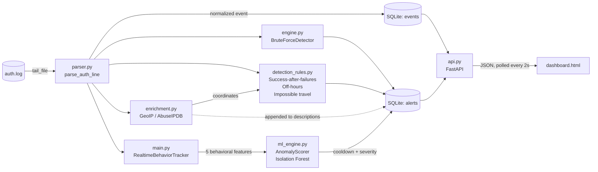

# 🛡️ SIEM Dashboard

A lightweight, real-time **Security Information and Event Management (SIEM)** system built from scratch in Python. It tails SSH authentication logs, normalizes them into structured events, and runs them through **two detection layers**: a set of **rule-based detectors** (brute force, successful-login-after-failures, off-hours logins, impossible travel) and an **Isolation Forest** ML model that scores each IP's behavior. Alerts are optionally enriched with GeoIP and reputation data, stored in SQLite, and served by a **FastAPI** backend (optionally token-protected) to a live dark-mode monitoring dashboard. The whole stack can be run with Docker Compose.

> Built as a hands-on cybersecurity + machine learning portfolio project to explore how real SIEM pipelines ingest, parse, correlate, enrich, and alert on log data.

---

## 📑 Table of Contents

- [Features](#-features)
- [Architecture](#-architecture)
- [How Detection Works](#-how-detection-works)
- [IP Enrichment](#-ip-enrichment)
- [Project Structure](#-project-structure)
- [Tech Stack](#-tech-stack)
- [Getting Started](#-getting-started)
- [Usage](#-usage)
- [Docker Deployment](#-docker-deployment)
- [Running the Tests](#-running-the-tests)
- [API Reference](#-api-reference)
- [Database Schema](#-database-schema)
- [Configuration & Tuning](#-configuration--tuning)
- [Known Limitations](#-known-limitations)
- [Roadmap](#-roadmap)
- [Disclaimer](#-disclaimer)

---

## ✨ Features

- **Real-time log tailing**: follows `auth.log` like `tail -f`, handles file truncation/rotation, partial lines, and even UTF-16 null bytes (PowerShell-generated logs).
- **Log parsing & normalization**: turns raw `sshd` lines into structured events (timestamp, hostname, source IP, user, status). Supports both modern ISO-8601 timestamps and legacy syslog format, and handles `invalid user` lines. A narrow set of `sudo` session lines and Suricata alert lines is parsed too (see [Known Limitations](#-known-limitations)).
- **Four rule-based detectors**: SSH brute force, successful login after many failures, off-hours logins, and impossible travel.
- **ML-based detection**: an unsupervised **Isolation Forest** scores each IP's behavioral profile and flags statistical outliers, catching things simple thresholds miss (slow-and-low attacks, password spraying across many usernames).
- **Score-based ML severity**: ML alerts are graded `CRITICAL` / `HIGH` / `MEDIUM` instead of a flat label.
- **Alert cooldown**: ML alerts are rate-limited per IP (default 5 minutes) so one noisy attacker doesn't flood the feed.
- **Optional IP enrichment**: cached GeoIP and AbuseIPDB reputation lookups are appended to alert descriptions. Private/reserved addresses are skipped, and provider failures never crash ingestion. Tests inject deterministic London/Tokyo GeoIP data so the impossible-travel scenario can run offline.
- **Persistent storage**: SQLite with indexes tuned for dashboard queries and ML feature extraction.
- **REST API**: FastAPI endpoints for stats, alerts (filterable by status), grouped incidents, and acknowledge/suppress actions.
- **Alert workflow**: every alert has a status (`active`, `acknowledged`, `suppressed`); suppressed alerts drop out of incident summaries.
- **Incident grouping**: repeated alerts are rolled up per attacker IP + rule with counts and first/last-seen times.
- **Optional token auth**: set `SIEM_API_TOKEN` and the dashboard and every API route require it.
- **Live dashboard**: a Tailwind-styled single-page console with color-coded severity and status badges, fixed-height responsive severity-distribution and top-attacker-IPs charts, and an alert table, refreshing every 2 seconds. Chart containers remain bounded as new data arrives so visualizations do not expand to fill the screen.
- **Docker support**: one image, two services (agent + API) wired together with `docker compose`.
- **Configurable**: log path via CLI flag or env var, and every rule threshold tunable through environment variables.
- **Unit tests**: 18 tests covering the parser, brute-force engine, extra rules, enrichment, and ML scoring.
- **Offline training/ingestion**: bulk-load a historical log file (e.g. the Loghub `OpenSSH_2k.log` dataset) to bootstrap the ML model.

---

## 🏗️ Architecture



**Data flow in one sentence:** a log line is tailed → parsed into an event → saved → fed to the rule detectors and the ML scorer → any alert is enriched with GeoIP/reputation info and saved (ML alerts pass a per-IP cooldown first) → the API serves it → the dashboard polls and displays it.

---

## 🧠 How Detection Works

### 1. Rule-Based Detectors

#### SSH Brute Force (`engine.py`)

`BruteForceDetector` keeps a `deque` of failed-login timestamps **per source IP**.

1. Ignore anything that isn't a `failed` event.
2. Drop timestamps older than the sliding window (`current_time - window`).
3. Append the new failure.
4. If the count reaches the threshold, raise an alert and **clear that IP's queue** so one burst doesn't spam duplicate alerts.

| Setting | Default |
|---|---|
| `threshold` | 3 failed attempts |
| `window_seconds` | 60 seconds |
| Rule name | `SSH_BRUTE_FORCE` |
| Severity | `HIGH` |

#### Streaming correlation rules (`detection_rules.py`)

| Rule | Triggers when | Severity | Defaults |
|---|---|---|---|
| `SUCCESS_AFTER_MANY_FAILURES` | A successful login follows enough failures for the **same IP + user** inside a time window. Often means a brute-force attempt finally worked. | `HIGH` | 5 failures within 300 s |
| `OFF_HOURS_LOGIN` | A **successful** login happens outside normal hours. Handles windows that cross midnight. | `MEDIUM` | 22:00 to 06:00 |
| `IMPOSSIBLE_TRAVEL` | The same user logs in successfully from two locations that would require faster-than-plausible travel, based on GeoIP coordinates. | `HIGH` | Max 800 km/h, compared within 24 h |

Details worth knowing:

- Failures are cleared after a `SUCCESS_AFTER_MANY_FAILURES` alert, so a single success doesn't fire repeatedly.
- `IMPOSSIBLE_TRAVEL` needs location data. It only works for public IPs where the GeoIP provider returned coordinates, and it tracks the last successful login **per user**. VPN and proxy users can cause false positives.
- `OFF_HOURS_LOGIN` uses the hour **as written in the log timestamp**. ISO timestamps with an offset (e.g. `+03:00`) are judged in that local time, while a server logging in UTC will be judged in UTC.

### 2. ML-Based: Isolation Forest (`ml_engine.py`)

Instead of hard-coded thresholds, the model learns what "normal" per-IP behavior looks like and flags what doesn't fit.

**Features computed per source IP:**

| Feature | Meaning |
|---|---|
| `total_attempts` | How many auth events this IP generated |
| `failure_rate` | Fraction of attempts that failed |
| `unique_users` | Number of distinct usernames targeted (high = password spraying / enumeration) |
| `mean_interval` | Average seconds between attempts (low = automated) |
| `std_interval` | Variation in timing (very low = machine-like regularity) |

**Preprocessing:** `total_attempts`, `unique_users`, `mean_interval` and `std_interval` are passed through `log1p` so heavy-tailed values don't drown out everything else.

**Training** (`train_model()`):
- Extracts one feature row per IP from the `events` table.
- Requires at least **5 IP profiles**.
- Trains `IsolationForest(n_estimators=150, contamination=0.35, random_state=42)`.
- Saves the model to `data/siem_isoforest.joblib` via `joblib`.

**Live scoring** (`AnomalyScorer`):
- `RealtimeBehaviorTracker` in `main.py` maintains an in-memory sliding history (last **50** events) per IP and computes the same five features on the fly.
- Scoring only starts once an IP has **≥ 3 attempts**.
- The model's `decision_function` score is compared against a threshold (default `0.05`); **lower score = more anomalous**.
- Anomalies produce an `ML_ANOMALOUS_BEHAVIOR` alert with the score, failure rate, and spray count in the description.
- A **per-IP cooldown** (default 5 minutes) suppresses repeat ML alerts for an IP that was already flagged.

**ML severity mapping** (`severity_from_score`):

| Score | Severity |
|---|---|
| `<= -0.2` | `CRITICAL` |
| `< 0` | `HIGH` |
| `< threshold` (default 0.05) | `MEDIUM` |
| otherwise | `LOW` (not an anomaly) |

---

## 🌍 IP Enrichment

`enrichment.py` adds context to alerts without ever being a hard dependency.

- **GeoIP**: country, city, and coordinates from a configurable provider (default `https://ipapi.co/{ip}/json/`). The coordinates also feed the impossible-travel rule.
- **AbuseIPDB** (optional): set `ABUSEIPDB_API_KEY` to add the abuse confidence score.
- **Cached**: results are cached per IP (default 1 hour), so repeated events don't trigger repeated provider calls.
- **Safe by design**: private, loopback, link-local, and reserved addresses are never sent to a provider, and any lookup failure or timeout is swallowed so detection keeps running.
- **Output**: alert descriptions get a suffix such as `[GeoIP: Berlin, Germany; AbuseIPDB confidence: 87%]`, or `[Private/reserved source IP]`.

---

## 📂 Project Structure

```
SIEM-Dashboard/
├── main.py              # Live agent: tail log → parse → store → detect (rules + ML) → enrich
├── parser.py            # Parses sshd (plus sudo and Suricata) log lines into structured events
├── engine.py            # BruteForceDetector (sliding-window rule engine)
├── detection_rules.py   # Success-after-failures, off-hours, and impossible-travel rules
├── enrichment.py        # Cached GeoIP / AbuseIPDB lookups
├── ml_engine.py         # Feature extraction, Isolation Forest training, AnomalyScorer, severity mapping
├── ingestionGen.py      # tail_file() generator: robust real-time file follower
├── ingestRealDB.py      # One-shot bulk ingestion of a historical log file
├── simulate_attacks.py  # Generates safe test log entries for detector scenarios
├── database.py          # SQLite schema, indexes, insert helpers
├── api.py               # FastAPI app: dashboard, JSON endpoints, optional token auth
├── dashboard.html       # Tailwind + Chart.js live monitoring console
├── config.py            # Central paths (data dir, DB path, model path)
├── requirements.txt     # Python dependencies
├── Dockerfile           # Image for both services (python:3.12-slim)
├── docker-compose.yml   # siem-agent + siem-api sharing ./data
├── .dockerignore
└── tests/               # Unit tests (parser, engine, rules, enrichment, ML)
    ├── test_parser.py
    ├── test_engine.py
    ├── test_detection_rules.py
    └── test_ml_engine.py
```

At runtime a `data/` directory is auto-created (and git-ignored) containing:

```
data/
├── siem.db                  # SQLite database (events + alerts)
└── siem_isoforest.joblib    # Trained Isolation Forest model
```

---

## 🧰 Tech Stack

| Layer | Technology |
|---|---|
| Language | Python 3.12 |
| Machine Learning | scikit-learn (IsolationForest), pandas, NumPy, joblib |
| Backend / API | FastAPI + Uvicorn |
| Storage | SQLite (`sqlite3` from the standard library) |
| Enrichment | Standard library `urllib` (ipapi.co by default, optional AbuseIPDB; injectable providers for offline tests) |
| Testing | `unittest` (also runs under `pytest`) |
| Frontend | Vanilla JS + Tailwind CSS + Chart.js (CDN) |
| Deployment | Docker + Docker Compose |

---

## 🚀 Getting Started

### Prerequisites

- Python **3.12** (or Docker + Docker Compose; see [Docker Deployment](#-docker-deployment))
- A Linux machine (or WSL/VM) with SSH logs at `/var/log/auth.log`, or any file containing `sshd` auth lines
- Read access to the log file (you may need `sudo`)
- Internet access is only needed if you want GeoIP / AbuseIPDB enrichment

### Installation

```bash
# 1. Clone the repo
git clone https://github.com/OmarAhmedTHE25th/SIEM-Dashboard.git
cd SIEM-Dashboard

# 2. (Recommended) create a virtual environment
python -m venv venv
source venv/bin/activate        # Windows: venv\Scripts\activate

# 3. Install dependencies
pip install -r requirements.txt
```

---

## ▶️ Usage

The system has three parts: **train the model**, **run the agent**, **run the dashboard**.

### Step 1: Bootstrap the ML model (recommended)

The ML detector needs a trained model. Without one, `AnomalyScorer.is_ready` stays `False` and only the rule-based detectors run.

Download a labeled-style SSH log sample (for example `OpenSSH_2k.log` from the [Loghub](https://github.com/logpai/loghub) dataset), place it in the project root, then:

```bash
python ingestRealDB.py     # parses the log and fills data/siem.db
python ml_engine.py        # trains the Isolation Forest and saves the model
```

> ⚠️ The training step needs **at least 5 distinct source IPs** in the events table.

### Step 2: Start the live agent

```bash
# Default: watches /var/log/auth.log
sudo python main.py

# Custom log file via CLI flag
python main.py --log-path /path/to/auth.log

# Or via environment variable
SIEM_LOG_PATH=/path/to/auth.log python main.py
```

Log path priority: `--log-path` / `-l` flag → `SIEM_LOG_PATH` env var → `/var/log/auth.log`.

The agent will:
1. Initialize the database (`init_db()`).
2. Load the trained model (and warn if it's missing).
3. Tail the log file and process each new `sshd` line in real time.

Console output stays quiet during normal operation and prints `[RULE ALERT]` or `[ML ALERT]` whenever a detector fires.

### Step 3: Start the dashboard

In a second terminal:

```bash
uvicorn api:app --reload --port 8000
```

Open **http://localhost:8000** to see the live console.

If `SIEM_API_TOKEN` is set, start uvicorn with it in the environment (`SIEM_API_TOKEN=change-me uvicorn api:app --port 8000`). The page itself is protected, so open `http://localhost:8000/?token=change-me` (a bare `http://localhost:8000` returns `401`). The dashboard then uses that token for its own API calls.

### Step 4: Generate test scenarios (optional)

For a repeatable local demonstration, `simulate_attacks.py` appends synthetic entries to
`/var/log/auth.log` (or `SIEM_LOG_PATH`). Run it on a test machine where you have permission
to write to the monitored log:

```bash
sudo python simulate_attacks.py
```

The script exercises these scenarios in sequence:

- `OFF_HOURS_LOGIN`
- `IMPOSSIBLE_TRAVEL` (the test suite uses an injected offline provider for the London/Tokyo IPs)
- `SUCCESS_AFTER_MANY_FAILURES`
- a `sudo` session event
- `ML_ANOMALOUS_BEHAVIOR` (a regular password-spray pattern)

It does not make network connections to attack systems or perform real authentication;
it only writes crafted log lines for the running agent to process. Watch the resulting
alerts appear on the dashboard within approximately 2 seconds. Set `SIEM_LOG_PATH` to use
a different file. The live agent uses its configured GeoIP provider; the deterministic
London/Tokyo data is kept in the tests and injected into `IPEnricher` there, so the
offline impossible-travel check never depends on a real provider.

---

## 🐳 Docker Deployment

The compose file builds one image and runs it as **two services** that share `./data`:

| Service | What it runs | Why separate |
|---|---|---|
| `siem-agent` | `python main.py`, tails the log, runs the detectors, writes events and alerts | Needs read access to the host's log directory |
| `siem-api` | `uvicorn api:app` on port `8000` | Serves the dashboard and REST API; reads the shared SQLite file |

```bash
# Build and start both services
docker compose up --build -d

# Open the dashboard (add ?token=... if you enabled a token)
# http://localhost:8000

# Require a token for the dashboard and API
SIEM_API_TOKEN=change-me docker compose up -d

# Follow the agent's alert output
docker compose logs -f siem-agent

# Stop everything (alerts and events stay in ./data)
docker compose down
```

**Train the ML model inside Docker** (the image doesn't include `*.log` files, so mount the dataset):

```bash
docker compose run --rm -v "$PWD/OpenSSH_2k.log:/app/OpenSSH_2k.log:ro" siem-agent \
  sh -c "python ingestRealDB.py && python ml_engine.py"
docker compose restart siem-agent      # reload the freshly trained model
```

Notes:

- The agent mounts the host's `/var/log` **read-only** and watches `/var/log/auth.log` by default; override with `SIEM_LOG_PATH`. This works on Linux hosts, since Docker Desktop on macOS/Windows doesn't expose the host's auth log this way.
- Compose passes through `SIEM_API_TOKEN` (API service) and `ABUSEIPDB_API_KEY` (agent). Put them in a `.env` file next to `docker-compose.yml` if you don't want them on the command line.
- The API service runs `init_db()` before starting, so it never fails because the agent hasn't created the database yet.
- Without a trained model the agent still runs, with the rule-based detectors only.
- Files in `./data` are created by the container user (root), so you may need `sudo` to edit or delete them on the host.

---

## 🧪 Running the Tests

```bash
python -m unittest discover -s tests
# or, if you have pytest installed
pytest
```

The suite covers the log parser (ISO and legacy formats, invalid users, malformed lines), the brute-force window logic, the three extra rules, enrichment caching and private-IP handling, and ML scoring/severity mapping.

---

## 🔌 API Reference

Base URL: `http://localhost:8000`

### Authentication

Authentication is **off by default**. When the `SIEM_API_TOKEN` environment variable is set on the API process, `GET /` and every `/api/*` route require the token, sent either way:

- Header: `Authorization: Bearer <token>`
- Query string: `?token=<token>` (convenient for opening the dashboard in a browser)

A missing or wrong token returns `401 Unauthorized`.

```bash
curl -H "Authorization: Bearer change-me" http://localhost:8000/api/stats
```

### `GET /`
Serves `dashboard.html`.

### `GET /api/stats`
Returns aggregate counters (total events, failed logins, total alerts, and distinct attacker IPs that triggered alerts).

```json
{
  "total_events": 2000,
  "failed_logins": 1450,
  "total_alerts": 14,
  "unique_attacker_ips": 6
}
```

### `GET /api/alerts?limit=50&status=active`
Returns the most recent alerts (newest first). `limit` defaults to `50`. The optional `status` filter accepts `active`, `acknowledged`, or `suppressed`.

```json
[
  {
    "id": 42,
    "timestamp": "2026-10-10T19:13:47.907110+00:00",
    "rule_name": "SSH_BRUTE_FORCE",
    "severity": "HIGH",
    "attacker_ip": "203.0.113.42",
    "target_user": "root",
    "description": "Observed 3 failed logins from 203.0.113.42 within 60.0s window. [GeoIP: Berlin, Germany]",
    "status": "active"
  }
]
```

### `GET /api/incidents?limit=10`
Groups alerts by **attacker IP + rule** (suppressed alerts excluded) and returns the noisiest groups first.

```json
[
  {
    "attacker_ip": "203.0.113.42",
    "rule_name": "SSH_BRUTE_FORCE",
    "count": 7,
    "first_seen": "2026-10-10T19:13:47+00:00",
    "last_seen": "2026-10-10T20:02:11+00:00",
    "suppressed_count": 0
  }
]
```

### `POST /api/alerts/{alert_id}/ack`
Marks an alert `acknowledged`. Returns `{"status": "acknowledged", "alert_id": 42}`, or `404` if the alert doesn't exist.

### `POST /api/alerts/{alert_id}/suppress`
Marks an alert `suppressed` (hidden from incident summaries). Returns `{"status": "suppressed", "alert_id": 42}`, or `404` if the alert doesn't exist.

Interactive docs are auto-generated by FastAPI at **`/docs`** (Swagger UI).

---

## 🗄️ Database Schema

**`events`**: every parsed auth event

| Column | Type | Notes |
|---|---|---|
| `id` | INTEGER PK | autoincrement |
| `timestamp` | TEXT | ISO-8601 |
| `hostname` | TEXT | |
| `source_ip` | TEXT | indexed; `local` for `sudo` session events |
| `user` | TEXT | target username |
| `status` | TEXT | `failed` or `success` (event outcome, not the alert workflow status) |
| `raw` | TEXT | original log line |

**`alerts`**: every triggered detection

| Column | Type | Notes |
|---|---|---|
| `id` | INTEGER PK | autoincrement |
| `timestamp` | TEXT | indexed |
| `rule_name` | TEXT | `SSH_BRUTE_FORCE`, `SUCCESS_AFTER_MANY_FAILURES`, `OFF_HOURS_LOGIN`, `IMPOSSIBLE_TRAVEL`, or `ML_ANOMALOUS_BEHAVIOR` |
| `severity` | TEXT | `CRITICAL`, `HIGH`, `MEDIUM`, or `LOW` (rules use fixed levels; ML is score-based) |
| `attacker_ip` | TEXT | |
| `target_user` | TEXT | |
| `description` | TEXT | human-readable explanation, with enrichment info appended |
| `status` | TEXT | alert workflow state: `active` (default), `acknowledged`, or `suppressed`; indexed |

---

## ⚙️ Configuration & Tuning

### Environment variables

| Variable | Purpose | Default |
|---|---|---|
| `SIEM_LOG_PATH` | Log file to monitor (overridden by `--log-path`) | `/var/log/auth.log` |
| `SIEM_SUCCESS_AFTER_FAILURES` | Failures needed before a success is suspicious | `5` |
| `SIEM_FAILURE_CORRELATION_WINDOW` | Window for that correlation (seconds) | `300` |
| `SIEM_OFF_HOURS_START` | Start of off-hours (hour, 0-23) | `22` |
| `SIEM_OFF_HOURS_END` | End of off-hours (hour, 0-23) | `6` |
| `SIEM_IMPOSSIBLE_TRAVEL_KMH` | Max plausible travel speed | `800` |
| `SIEM_IMPOSSIBLE_TRAVEL_WINDOW` | How far back to compare logins (seconds) | `86400` |
| `SIEM_GEOIP_URL` | GeoIP provider URL template (`{ip}` placeholder) | `https://ipapi.co/{ip}/json/` |
| `SIEM_GEOIP_CACHE_TTL` | Enrichment cache lifetime (seconds) | `3600` |
| `SIEM_ENRICHMENT_TIMEOUT` | Per-request provider timeout (seconds) | `2.0` |
| `ABUSEIPDB_API_KEY` | Enables AbuseIPDB reputation checks | unset (disabled) |
| `SIEM_API_TOKEN` | Enables token auth for the dashboard and API (read by the API process) | unset (open access) |

### In-code settings

| What | Where | Default |
|---|---|---|
| Data directory / DB / model paths | `config.py` | `./data/` |
| Brute-force threshold & window | `BruteForceDetector(...)` in `main.py` | `3` / `60s` |
| ML anomaly sensitivity | `AnomalyScorer(score_threshold=...)` | `0.05` (raise = more alerts) |
| Min events before ML scores an IP | `main.py` | `3` |
| ML alert cooldown per IP | `ML_ALERT_COOLDOWN` in `main.py` | `5 minutes` |
| Per-IP history length | `RealtimeBehaviorTracker(max_history=...)` | `50` |
| Expected anomaly ratio during training | `contamination` in `train_model()` | `0.35` |
| Dashboard refresh rate | `setInterval` in `dashboard.html` | `2000 ms` |
| Dashboard chart height | `.chart-container` in `dashboard.html` | `240 px` |

---

## ⚠️ Known Limitations

- **Narrow log coverage**: the parser matches `Failed password` / `Accepted password` from `sshd`, a minimal `sudo` session pattern, and Suricata lines containing `ET `. Key-based SSH auth and other services are ignored, so the success-based rules only see password logins.
- **Non-SSH events reuse the SSH event model**: `sudo` session lines become `success` events with source IP `local` (so they can trigger `OFF_HOURS_LOGIN` and feed the ML tracker as one pseudo-IP), and Suricata lines become `failed` events keyed on the first `IP:port` found, so they count toward failed-login stats and the brute-force rule.
- **Legacy syslog year**: the legacy timestamp fallback hardcodes the year `2026` since classic syslog omits it.
- **Timezone-naive rules**: legacy syslog timestamps carry no timezone, and `OFF_HOURS_LOGIN` judges the hour exactly as written in the log, so it follows the log's own timezone rather than a configured one.
- **Enrichment sends IPs to a third party**: with the default settings, public source IPs are sent to ipapi.co (and to AbuseIPDB if you set a key). Point `SIEM_GEOIP_URL` at your own provider if that's a concern.
- **Enrichment is synchronous**: failures are ignored, but a slow provider can delay processing by up to the timeout (2 s by default) the first time a new public IP is seen.
- **Impossible travel is approximate**: GeoIP is city-level at best, and VPNs/proxies can trigger false positives.
- **Training data quality**: `contamination=0.35` is tuned for a noisy historical sample, not for a clean production baseline.
- **Simple shared-token auth**: one optional token, with no users, roles, or TLS. The `?token=` query-string option can end up in server logs and browser history, and the dashboard keeps the token in the browser's `localStorage`. Prefer the header, and put the app behind a reverse proxy with HTTPS before exposing it beyond localhost.
- **Dashboard shows recent alerts only**: the table and both charts are built from the 20 most recent alerts, not the full history. Acknowledge/suppress and incident grouping are API-only for now (there are no buttons for them in the UI).
- **Docker log access is Linux-only by default**: the agent container reads the host's `/var/log` through a read-only mount.

---

## 🗺️ Roadmap

### Completed

- [x] Add `requirements.txt`
- [x] Fix `failed_logins` stat in `/api/stats`
- [x] Alert cooldown for ML alerts
- [x] Configurable log path via CLI args or env vars
- [x] More detection rules (successful login after many failures, impossible travel, off-hours logins)
- [x] IP enrichment (GeoIP, reputation lookup)
- [x] Alert severity levels based on ML score
- [x] SQLite-backed event and alert storage with live dashboard polling
- [x] Offline historical ingestion and model training workflow

### Near-term improvements

- [x] Add authentication and authorization for the API/dashboard in production deployments
- [x] Support more log sources beyond SSH (`sudo` / `suricata` / syslog-friendly parsing)
- [x] Add alert suppression and acknowledgement workflows for monitoring operations
- [x] Improve correlation by grouping related alerts into incident summaries
- [x] Add richer dashboard charts for trends over time, top offending IPs, and rule distributions
- [x] Package the stack for easier deployment with Docker and docker-compose

### Longer-term vision

- [ ] Add a true threat-hunting workflow with search/filtering across historical detections
- [ ] Integrate external threat intel, asset inventory, and user-context enrichment
- [ ] Introduce streaming pipeline metrics, SLOs, and alert health monitoring
- [ ] Expand the ML layer with supervised labels and a retraining pipeline for tuned detection
- [ ] Turn this into a reusable blueprint for broader enterprise SIEM and SOC tooling

---

## 📜 Disclaimer

This project is for **educational and defensive-security purposes only**. Only monitor systems and generate test traffic on machines you own or have explicit permission to test.

---

## 👤 Author

**Omar Ahmed**: Computer Engineering student, cybersecurity enthusiast.
GitHub: [@OmarAhmedTHE25th](https://github.com/OmarAhmedTHE25th)