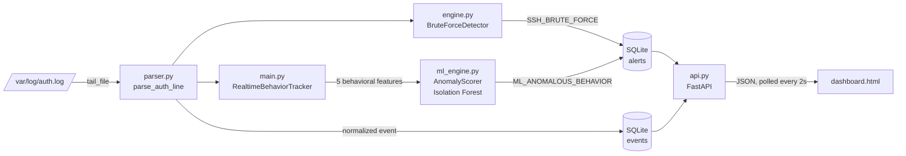

#  SIEM Dashboard

A lightweight, real-time **Security Information and Event Management (SIEM)** system built from scratch in Python. It tails SSH authentication logs, normalizes them into structured events, detects attacks using **two complementary engines** (a rule-based sliding-window detector and an **Isolation Forest** ML model), stores everything in SQLite, and exposes it through a **FastAPI** backend with a live dark-mode monitoring dashboard.

> Built as a hands-on cybersecurity + machine learning portfolio project to explore how real SIEM pipelines ingest, parse, correlate, and alert on log data.

---

##  Table of Contents

- [Features](#-features)
- [Architecture](#-architecture)
- [How Detection Works](#-how-detection-works)
- [Project Structure](#-project-structure)
- [Tech Stack](#-tech-stack)
- [Getting Started](#-getting-started)
- [Usage](#-usage)
- [API Reference](#-api-reference)
- [Database Schema](#-database-schema)
- [Configuration & Tuning](#-configuration--tuning)
- [Known Limitations](#-known-limitations)
- [Roadmap](#-roadmap)
- [Disclaimer](#-disclaimer)

---

##  Features

- **Real-time log tailing**: follows `auth.log` like `tail -f`, handles file truncation/rotation, partial lines, and even UTF-16 null bytes (PowerShell-generated logs).
- **Log parsing & normalization**: turns raw `sshd` lines into structured events (timestamp, hostname, source IP, user, status). Supports both modern ISO-8601 timestamps and legacy syslog format.
- **Rule-based detection**: a per-IP sliding-window brute-force detector (default: 3 failed logins within 60 seconds).
- **ML-based detection**: an unsupervised **Isolation Forest** scores each IP's behavioral profile and flags statistical outliers, catching things simple thresholds miss (slow-and-low attacks, password spraying across many usernames).
- **Alert cooldown**: ML alerts are rate-limited per IP (default 5 minutes) so one noisy attacker doesn't flood the feed.
- **Persistent storage**: SQLite with indexes tuned for dashboard queries and ML feature extraction.
- **REST API**: FastAPI endpoints for stats and alerts.
- **Live dashboard**: a Tailwind-styled single-page console that auto-refreshes every 2 seconds.
- **Offline training/ingestion**: bulk-load a historical log file (e.g. the Loghub `OpenSSH_2k.log` dataset) to bootstrap the ML model.

---

##  Architecture



**Data flow in one sentence:** a log line is tailed → parsed into an event → saved → fed to both detectors → any alert is saved (ML alerts pass a per-IP cooldown first) → the API serves it → the dashboard polls and displays it.

---

##  How Detection Works

### 1. Rule-Based: SSH Brute Force (`engine.py`)

`BruteForceDetector` keeps a `deque` of failed-login timestamps **per source IP**.

1. Ignore anything that isn't a `failed` event.
2. Drop timestamps older than the sliding window (`current_time - window`).
3. Append the new failure.
4. If the count reaches the threshold, raise an alert and **clear that IP's queue** so one burst doesn't spam duplicate alerts.

| Setting | Default |
|---|---|
| `threshold` | 3 failed attempts |
| `window_seconds` | 60 seconds |
| Rule name | `SSH_BRUTE_FORCE` |
| Severity | `HIGH` |

### 2. ML-Based: Isolation Forest (`ml_engine.py`)

Instead of hard-coded thresholds, the model learns what "normal" per-IP behavior looks like and flags what doesn't fit.

**Features computed per source IP:**

| Feature | Meaning |
|---|---|
| `total_attempts` | How many auth events this IP generated |
| `failure_rate` | Fraction of attempts that failed |
| `unique_users` | Number of distinct usernames targeted (high = password spraying / enumeration) |
| `mean_interval` | Average seconds between attempts (low = automated) |
| `std_interval` | Variation in timing (very low = machine-like regularity) |

**Preprocessing:** `total_attempts`, `unique_users`, `mean_interval` and `std_interval` are passed through `log1p` so heavy-tailed values don't drown out everything else.

**Training** (`train_model()`):
- Extracts one feature row per IP from the `events` table.
- Requires at least **5 IP profiles**.
- Trains `IsolationForest(n_estimators=150, contamination=0.35, random_state=42)`.
- Saves the model to `data/siem_isoforest.joblib` via `joblib`.

**Live scoring** (`AnomalyScorer`):
- `RealtimeBehaviorTracker` in `main.py` maintains an in-memory sliding history (last **50** events) per IP and computes the same five features on the fly.
- Scoring only starts once an IP has **≥ 3 attempts**.
- The model's `decision_function` score is compared against a threshold (default `0.05`); **lower score = more anomalous**.
- Anomalies produce an `ML_ANOMALOUS_BEHAVIOR` alert with the score, failure rate, and spray count in the description. ML severity is score-based: `CRITICAL` at `<= -0.2`, `HIGH` below `0`, and `MEDIUM` below the anomaly threshold; non-anomalous scores map to `LOW`.
- A **per-IP cooldown** (default 5 minutes) suppresses repeat ML alerts for an IP that was already flagged, so a single attacker doesn't generate an alert on every event.

> 💡 **Why both?** Rules are fast, explainable, and predictable. ML catches the behaviors you didn't think to write a rule for. Running them side by side is how many production SIEMs work.

---

##  Project Structure

```
SIEM-Dashboard/
├── main.py            # Live agent: tail log → parse → store → detect (rules + ML)
├── parser.py          # Parses raw sshd auth lines into structured events
├── engine.py          # BruteForceDetector (sliding-window rule engine)
├── ml_engine.py       # Feature extraction, Isolation Forest training, AnomalyScorer
├── ingestionGen.py    # tail_file() generator: robust real-time file follower
├── ingestRealDB.py    # One-shot bulk ingestion of a historical log file
├── database.py        # SQLite schema, indexes, insert helpers
├── api.py             # FastAPI app: serves dashboard + JSON endpoints
├── dashboard.html     # Tailwind-based live monitoring console
└── config.py          # Central paths (data dir, DB path, model path)
```

At runtime a `data/` directory is auto-created containing:

```
data/
├── siem.db                  # SQLite database (events + alerts)
└── siem_isoforest.joblib    # Trained Isolation Forest model
```

---

##  Tech Stack

| Layer | Technology |
|---|---|
| Language | Python 3.12 |
| Machine Learning | scikit-learn (IsolationForest), pandas, NumPy, joblib |
| Backend / API | FastAPI + Uvicorn |
| Storage | SQLite (`sqlite3` from the standard library) |
| Frontend | Vanilla JS + Tailwind CSS (CDN) |

---

##  Getting Started

### Prerequisites

- Python **3.10 or newer**
- A Linux machine (or WSL/VM) with SSH logs at `/var/log/auth.log`, or any file containing `sshd` auth lines
- Read access to the log file (you may need `sudo`)

### Installation

```bash
# 1. Clone the repo
git clone https://github.com/OmarAhmedTHE25th/SIEM-Dashboard.git
cd SIEM-Dashboard

# 2. (Recommended) create a virtual environment
python -m venv venv
source venv/bin/activate        # Windows: venv\Scripts\activate

# 3. Install dependencies
pip install fastapi uvicorn scikit-learn pandas numpy joblib
```

---

## Usage

The system has three parts: **train the model**, **run the agent**, **run the dashboard**.

### Step 1: Bootstrap the ML model (recommended)

The ML detector needs a trained model. Without one, `AnomalyScorer.is_ready` stays `False` and only the rule-based detector runs.

Download a labeled-style SSH log sample (for example `OpenSSH_2k.log` from the [Loghub](https://github.com/logpai/loghub) dataset), place it in the project root, then:

```bash
python ingestRealDB.py     # parses the log and fills data/siem.db
python ml_engine.py        # trains the Isolation Forest and saves the model
```

>  The training step needs **at least 5 distinct source IPs** in the events table.

### Step 2: Start the live agent

```bash
sudo python main.py
```

The agent will:
1. Initialize the database (`init_db()`).
2. Load the trained model.
3. Tail `/var/log/auth.log` and process each new `sshd` line in real time.

Console output stays quiet during normal operation and prints `[RULE ALERT]` or `[ML ALERT]` whenever a detector fires. If the model file is missing, the agent warns you at startup and runs with the rule-based detector only.

### Step 3: Start the dashboard

In a second terminal:

```bash
uvicorn api:app --reload --port 8000
```

Open **http://localhost:8000** to see the live console.

### Step 4: Generate some traffic

Trigger some failed SSH logins against the monitored machine (only on systems you own) and watch alerts appear on the dashboard within ~2 seconds.

---

## 🔌 API Reference

Base URL: `http://localhost:8000`

### `GET /`
Serves `dashboard.html`.

### `GET /api/stats`
Returns aggregate counters (total events, failed logins, total alerts, and distinct attacker IPs that triggered alerts).

```json
{
  "total_events": 2000,
  "failed_logins": 1450,
  "total_alerts": 14,
  "unique_attacker_ips": 6
}
```

### `GET /api/alerts?limit=50`
Returns the most recent alerts (newest first). `limit` defaults to `50`.

```json
[
  {
    "timestamp": "2026-10-10T19:13:47.907110+00:00",
    "rule_name": "SSH_BRUTE_FORCE",
    "severity": "HIGH",
    "attacker_ip": "203.0.113.42",
    "target_user": "root",
    "description": "Observed 3 failed logins from 203.0.113.42 within 60.0s window."
  }
]
```

Interactive docs are auto-generated by FastAPI at **`/docs`** (Swagger UI).

---

## 🗄️ Database Schema

**`events`**: every parsed auth event

| Column | Type | Notes |
|---|---|---|
| `id` | INTEGER PK | autoincrement |
| `timestamp` | TEXT | ISO-8601 |
| `hostname` | TEXT | |
| `source_ip` | TEXT | indexed |
| `user` | TEXT | target username |
| `status` | TEXT | `failed` or `success` |
| `raw` | TEXT | original log line |

**`alerts`**: every triggered detection

| Column | Type | Notes |
|---|---|---|
| `id` | INTEGER PK | autoincrement |
| `timestamp` | TEXT | indexed |
| `rule_name` | TEXT | `SSH_BRUTE_FORCE` or `ML_ANOMALOUS_BEHAVIOR` |
| `severity` | TEXT | `HIGH` for rule alerts; ML score-based `CRITICAL`, `HIGH`, `MEDIUM`, or `LOW` |
| `attacker_ip` | TEXT | |
| `target_user` | TEXT | |
| `description` | TEXT | human-readable explanation |

---

## Configuration & Tuning

| What | Where | Default |
|---|---|---|
| Log file to monitor | `LOG_PATH` in `main.py` | `/var/log/auth.log` |
| Data directory / DB / model paths | `config.py` | `./data/` |
| Brute-force threshold & window | `BruteForceDetector(...)` in `main.py` | `3` / `60s` |
| ML anomaly sensitivity | `AnomalyScorer(score_threshold=...)` | `0.05` (raise = more alerts) |
| Min events before ML scores an IP | `main.py` | `3` |
| ML alert cooldown per IP | `ML_ALERT_COOLDOWN` in `main.py` | `5 minutes` |
| Per-IP history length | `RealtimeBehaviorTracker(max_history=...)` | `50` |
| Expected anomaly ratio during training | `contamination` in `train_model()` | `0.35` |
| Dashboard refresh rate | `setInterval` in `dashboard.html` | `2000 ms` |

---

##  Known Limitations

- **SSH password auth only**: the parser matches `Failed password` / `Accepted password` from `sshd`. Key-based auth, invalid-user lines without a password message, and other services are ignored.
- **Legacy syslog year**: the legacy timestamp fallback hardcodes the year `2026` since classic syslog omits it.
- **Hardcoded log path**: `LOG_PATH` is a constant in `main.py`; Windows or custom log locations require editing it.
- **Training data quality**: `contamination=0.35` is tuned for a noisy historical sample, not for a clean production baseline.
- **No auth on the API/dashboard**: it's meant for local use. Don't expose it to the internet as is.

---

##  Roadmap

- [x] Add `requirements.txt`
- [x] Fix `failed_logins` stat in `/api/stats`
- [x] Alert cooldown for ML alerts
- [x] Configurable log path via CLI args or env vars
- [ ] More detection rules (successful login after many failures, impossible travel, off-hours logins)
- [ ] IP enrichment (GeoIP, reputation lookup)
- [x] Alert severity levels based on ML score
- [ ] Dashboard charts (attacks over time, top attacker IPs, targeted usernames)
- [ ] Automatic periodic model retraining
- [x] Unit tests for the parser and detectors
- [ ] Docker support

---

##  Disclaimer

This project is for **educational and defensive-security purposes only**. Only monitor systems and generate test traffic on machines you own or have explicit permission to test.

---

## 👤 Author

**Omar Ahmed**: Computer Engineering student, cybersecurity enthusiast.
GitHub: [@OmarAhmedTHE25th](https://github.com/OmarAhmedTHE25th)
