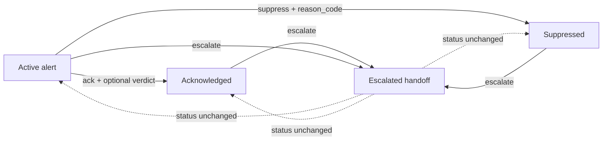

# Alert triage workflow

Alerts start as `active` findings. An analyst can acknowledge an alert and
optionally record a verdict and explanation, suppress it with a controlled
reason code, or escalate it for follow-up. Escalation records the time of the
handoff without changing the alert's current status. Triage metadata is
additive, so existing alert records and API clients remain compatible.

## Workflow

1. Review the alert from `GET /api/alerts` or `GET /api/alerts/{id}`.
2. Acknowledge it with `POST /api/alerts/{id}/ack`. The optional `verdict`
   values are `true_positive`, `false_positive`, and
   `benign_true_positive`; `reason` is free text.
3. Suppress known noise with
   `POST /api/alerts/{id}/suppress` and a `reason_code` of `known_scanner`,
   `authorized_test`, `monitoring_account`, or `tuning_needed`.
4. Escalate with `POST /api/alerts/{id}/escalate`. This sets `escalated_at`
   and preserves `active`, `acknowledged`, or `suppressed` status.

The dashboard exposes acknowledge, suppress, and escalate controls in each
alert row. Suppression uses a reason-code dropdown; acknowledgement prompts
for the optional verdict and reason.
